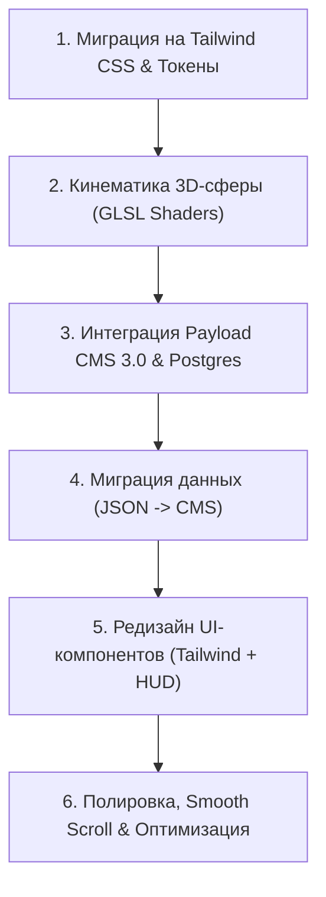

# План модернизации портфолио: The Digital Collider

> **Арт-дирекшн**: Интеллектуальный технократичный люкс (High-End Cyberpunk / Industrial Precision)  
> **Цветовая палитра**: Obsidian Void (`#090A0C`), Panels (`#111317`), Hairline Zinc (`#22262E`), Acid-Lime (`#E2F163`)  
> **Стек технологий**: Next.js 16 (App Router), React 19, Tailwind CSS, Three.js / @react-three/fiber (GLSL Shaders), Payload CMS 3.0, PostgreSQL

---

---

## Этап 1: Миграция на Tailwind CSS и настройка дизайн-системы
- [ ] Установка и настройка Tailwind CSS в проект.
- [ ] Конфигурация дизайн-токенов:
  - Цвета: `obsidian: '#090A0C'`, `surface: '#111317'`, `hairline: '#22262E'`, `lime: '#E2F163'`, `text-primary: '#F2F4F7'`, `text-muted: '#6B7280'`.
  - Шрифты: подключение через `next/font` (`PP Neue Montreal` / `Geist Sans` / `Commit Mono` или `JetBrains Mono`).
  - Утилиты для Frosted Glass (`backdrop-blur-xl`, `bg-surface/65`, hairline border `border-hairline`).
- [ ] Замена SCSS-стилей на Tailwind CSS классы.

---

## Этап 2: Кинематика 3D-сферы (React Three Fiber & Custom Shaders)
- [ ] Модернизация компонента [src/components/sphere.tsx](file:///home/alex/apps/main/resume/src/components/sphere.tsx):
  - Перевод вычислений с CPU `lerp` на кастомный GLSL вершинный шейдер (`ShaderMaterial` с Simplex/Perlin Noise).
  - Реализация физики отталкивания частиц от экранного курсора с упругим возвратом (Magnetic Repulsion).
  - Морфинг формы сферы по секциям страницы:
    - *Обо мне*: спокойная пульсация квантового поля;
    - *Опыт*: аксиальный вихрь / временная шкала;
    - *Проекты*: направленная плотность / световой радар превью проекта.
- [ ] Оптимизация производительности: адаптивный DPR, пауза рендеринга при скрытой вкладке (Page Visibility API).

---

## Этап 3: Интеграция Payload CMS 3.0 в Next.js 16
- [ ] Установка пакетов Payload CMS 3.0: `payload`, `@payloadcms/next`, `@payloadcms/db-postgres`, `@payloadcms/richtext-lexical`.
- [ ] Настройка `payload.config.ts` с поддержкой TypeScript и Next.js App Router:
  - Роуты админки: `/admin` через `(payload)/admin`.
  - Подключение к PostgreSQL через `@payloadcms/db-postgres` (`DATABASE_URI`).
- [ ] Проектирование коллекций:
  - `Projects`: заголовок, слаг, описание (Lexical), технологии, метрики (`key-value`), ссылки, превью-медиа, поле `shaderPreset` (`orbital`, `turbulent`, `wireframe`, `vortex`).
  - `Experiences`: компания, должность, период, достижения, теги.
  - `Technologies`: название, категория (`Core`, `3D/Creative`, `Architecture`, `Tools`), цвет акцента.
  - `SiteSettings` (Global): персональные данные, био, статус доступности, социальные ссылки, файл резюме.

---

## Этап 4: Миграция существующих данных в Payload CMS
- [ ] Создание скрипта миграции для автоматического импорта данных из:
  - [src/content.tsx](file:///home/alex/apps/main/resume/src/content.tsx) $\rightarrow$ `SiteSettings`
  - [public/data/works.json](file:///home/alex/apps/main/resume/public/data/works.json) $\rightarrow$ `Experiences`
  - [public/data/projects.json](file:///home/alex/apps/main/resume/public/data/projects.json) $\rightarrow$ `Projects` & `Technologies`
- [ ] Проверка корректности заполнения через админ-панель Payload.

---

## Этап 5: Редизайн UI-компонентов на Tailwind CSS
- [ ] Перевод страниц на Server Components Next.js 16 с прямым получением данных через Local API Payload (`getPayload`).
- [ ] Модернизация [src/components/main-page.tsx](file:///home/alex/apps/main/resume/src/components/main-page.tsx):
  - Левая колонка: моноширинные статусы, аналоговый скраббер навигации, магнитные кнопки соцсетей.
  - Правая колонка: секции со стеклянными карточками, акцентными бейджами и динамическим превью.
- [ ] Реализация режима Developer HUD (`[HUD: ON]` / клавиша `Space`):
  - Метрики производительности, FPS, WebGL draw calls, статус гидратации Next.js.
  - Терминальные всплывающие карточки с описанием архитектурных решений каждого проекта.

---

## Этап 6: Полировка, анимации и релиз
- [ ] Интеграция плавного скролла (Lenis Scroll).
- [ ] Пружинные микро-интеракции (Framer Motion: `stiffness: 260, damping: 20`).
- [ ] Финальная проверка Lighthouse (Performance, Accessibility, SEO).
- [ ] Проверка сборки проекта (`npm run build`).
